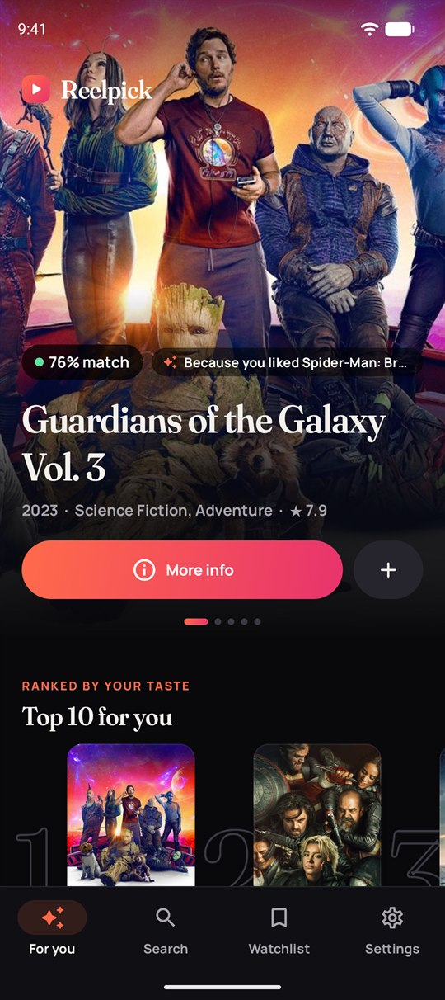
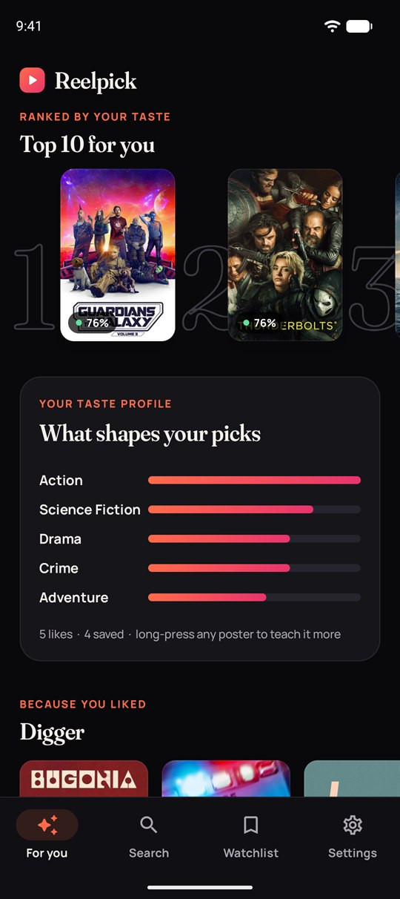
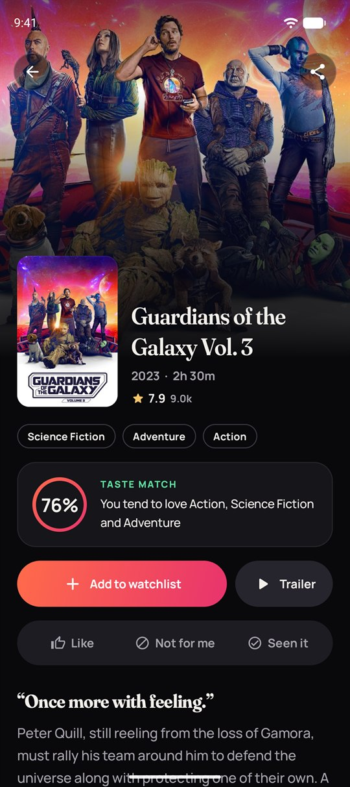
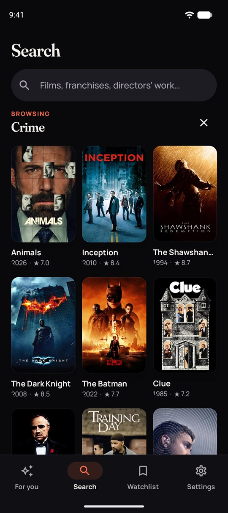
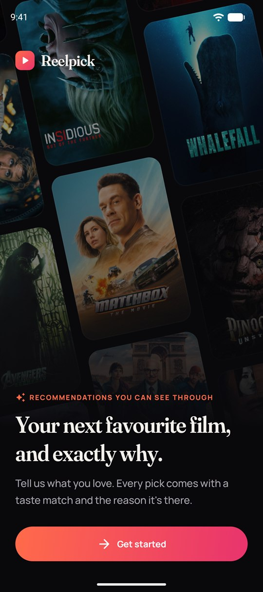
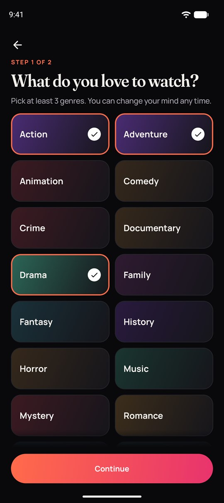
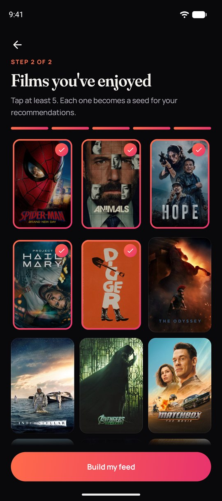
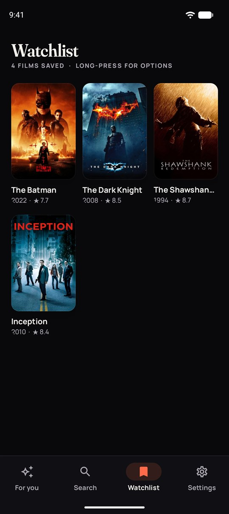

# Reelpick: movie recommendations you can see through

An Android app that learns what you like and builds a personal **For You** feed. Every pick shows a **taste match** and **why it's there** ("Because you liked *Arrival*"), and the app shows you the taste profile it has learned. Built with Jetpack Compose, Hilt, Room and the TMDB API.

<table>
  <tr>
    <td align="center"><br><sub><b>For You</b>: match % and why</sub></td>
    <td align="center"><br><sub><b>Top 10 + taste profile</b></sub></td>
    <td align="center"><br><sub><b>Details</b>: why it fits you</sub></td>
    <td align="center"><br><sub><b>Search</b>: browse by genre</sub></td>
  </tr>
  <tr>
    <td align="center"><br><sub><b>Welcome</b></sub></td>
    <td align="center"><br><sub><b>Pick genres</b></sub></td>
    <td align="center"><br><sub><b>Pick seed films</b></sub></td>
    <td align="center"><br><sub><b>Watchlist</b> (offline)</sub></td>
  </tr>
</table>

<sub>Captured on a Pixel emulator (Android 16) with live TMDB data. Saving four crime and drama films shifted the profile, which is why "Crime" appears in the taste card and the matches read 76%.</sub>

## Design

A dark-first, cinematic UI built from scratch as a small design system (`ui/theme`, `ui/common`):

- **Type:** Fraunces (display) paired with Manrope (UI), both variable fonts bundled under the SIL OFL.
- **Brand:** ember-to-magenta gradient, near-black surfaces, custom adaptive and themed launcher icon, and a branded splash screen.
- **Motion:** shared-element poster transitions into details, hero parallax, an auto-advancing hero, shimmer skeletons, and haptics on ratings.
- **Explainability:** taste-match badges, reason pills, and a "What shapes your picks" card that shows the learned genre weights.

## Features

- **Onboarding**: a cinematic welcome over a drifting poster mosaic. Then pick 3 or more genres and at least 5 films you've enjoyed; these seed your taste profile.
- **For You feed**: a full-bleed hero carousel, a ranked *Top 10 for you*, your taste profile, and rows for *Because you liked X*, *Your genres* and *Trending*. Pull to refresh, and long-press any poster to like, dislike, hide it or save it.
- **Live re-ranking**: a dislike or "not interested" reorders the feed immediately, offline; a new like brings in fresh candidates.
- **Movie details**: cast, trailer, runtime, genres, **where to watch** (stream, rent or buy for your region) and "More like this".
- **Search**: debounced and paginated, with recent searches and *Browse by genre* tiles.
- **Watchlist**: an offline poster grid. Long-press to mark as watched or remove, with undo.
- **Settings**: streaming region, light/dark/system theme, and a taste-profile reset.

## How recommendations work

The engine lives in [`domain/recommend`](app/src/main/java/com/myth/movieapp/domain/recommend). It's plain Kotlin with no Android dependencies and is fully unit-tested.

1. **Taste profile** ([`TasteProfile`](app/src/main/java/com/myth/movieapp/domain/recommend/TasteProfile.kt)). Each genre gets a weight from explicit signals only:

   | Signal | Weight per genre |
   |---|---|
   | Genre picked in onboarding | +1 |
   | Liked movie | +2 |
   | Disliked / not interested | −2 |
   | On watchlist | +1 |

   Weights are normalised so the strongest genre has a weight of 1. A movie's fit is the cosine similarity between its genres and this profile.

2. **Candidates** ([`CandidateSource`](app/src/main/java/com/myth/movieapp/domain/recommend/CandidateSource.kt)), fetched concurrently:
   - TMDB recommendations for your 5 most recent likes (the "seeds")
   - Well-voted movies in your top 3 genres
   - This week's trending movies, for exploration

   The feed fails only if every source fails.

3. **Ranking** ([`RecommendationRanker`](app/src/main/java/com/myth/movieapp/domain/recommend/RecommendationRanker.kt)):

   ```
   score = 0.45 · genre affinity
         + 0.30 · seed support      (how many of your likes recommended it, capped at 3)
         + 0.20 · Bayesian rating   (a 9.0 from 12 votes doesn't beat an 8.4 from 20k)
         + 0.05 · freshness         (linear decay over 10 years)
   ```

   Movies you've rated, saved or watched are filtered out. A diversity pass then stops more than two picks in a row from sharing the same dominant genre. Each pick keeps the reason it was chosen.

4. **Feed** ([`GetForYouFeedUseCase`](app/src/main/java/com/myth/movieapp/domain/recommend/GetForYouFeedUseCase.kt)) splits the ranked list into sections and caches it in Room, so the home screen opens instantly and works offline.

## Architecture

```
ui/            Compose screens + @HiltViewModel per screen (StateFlow UI state)
  onboarding/  foryou/  details/  search/  watchlist/  settings/  navigation/  theme/  common/
domain/        Pure Kotlin: models, repository interfaces, recommendation engine
data/          Retrofit (TMDB), Room (feedback, watchlist, genres, feed cache), DataStore (prefs)
di/            Hilt modules
```

- Single activity with type-safe Navigation Compose routes.
- Offline-first: the feed, watchlist and ratings live in Room. The network only adds or refreshes data.
- Repositories return `Result` rather than throwing. The UI maps errors to clear messages (offline, bad token, missing token).
- The TMDB token is sent as a bearer header by an OkHttp interceptor, so it never appears in URLs or logs.

## Tech stack

Kotlin 2.1 · Jetpack Compose (Material 3) · Navigation Compose · Hilt · KSP · Room · DataStore · Retrofit + OkHttp + kotlinx.serialization · Coil 3 · Coroutines/Flow · JUnit, Turbine, Compose UI tests · GitHub Actions

## How to run

1. Clone the project and open it in Android Studio:
   ```bash
   git clone https://github.com/MichaelGift/Movie-Recommendations-App.git
   ```
2. Get a TMDB **API Read Access Token** (v4) from [TMDB → Settings → API](https://www.themoviedb.org/settings/api).
3. Add it to `local.properties` in the project root. This file is git-ignored, so the token is never committed:
   ```properties
   TMDB_ACCESS_TOKEN=your_v4_read_access_token
   ```
   On CI, set a `TMDB_ACCESS_TOKEN` repository secret instead. Without a token the app still builds and explains what's missing.
4. Sync Gradle and run the `app` configuration. You need JDK 17 or newer; Android Studio's bundled JDK works.

## Tests

```bash
./gradlew testDebugUnitTest
```

```bash
./gradlew connectedDebugAndroidTest
```

- **Unit tests** (JVM) cover the taste profile, the ranker, candidate sourcing, the feed use case, and the onboarding and search ViewModels.
- **Instrumented tests** cover the Room repositories, plus Compose UI tests for onboarding and the details screen's watchlist action.

## Attribution

This product uses the TMDB API but is not endorsed or certified by TMDB. Movie data and images © [TMDB](https://www.themoviedb.org/). Streaming availability is provided by JustWatch.

## Contributing

Suggestions and fixes are welcome. Fork the repository, make your changes, and open a pull request.
