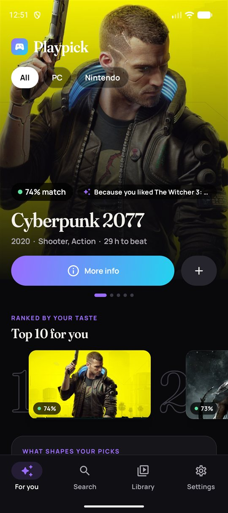
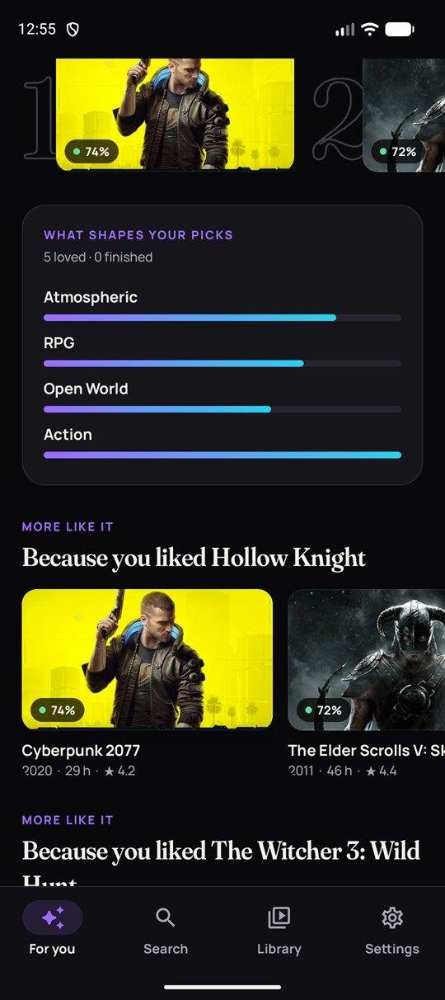
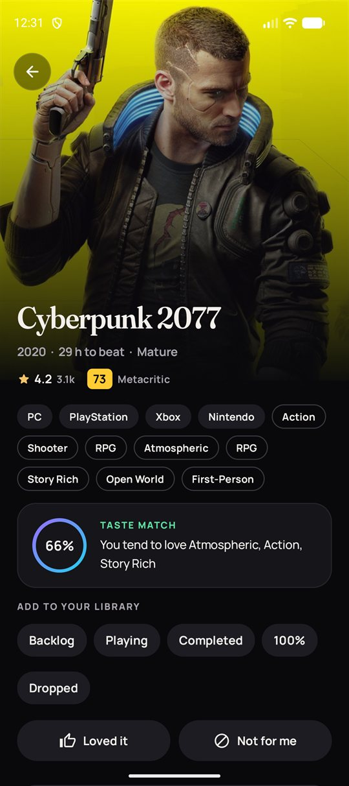
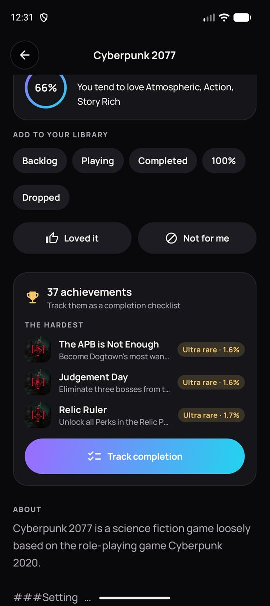
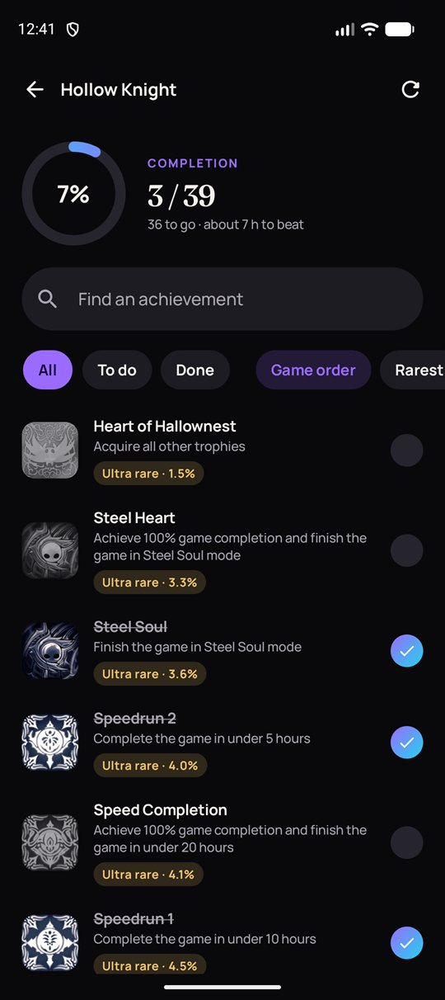
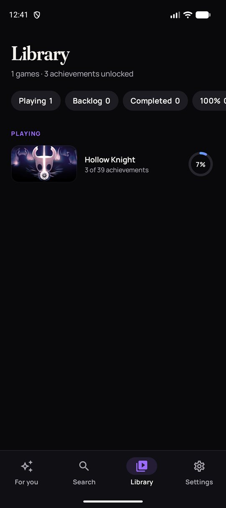
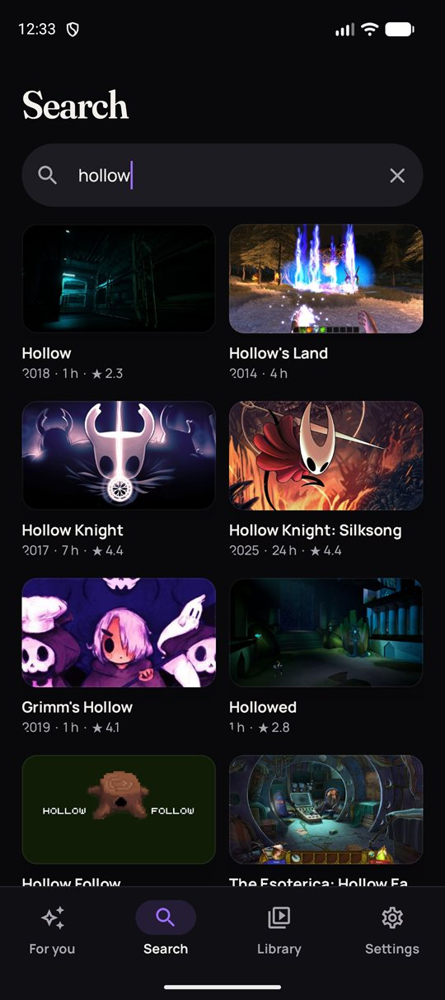
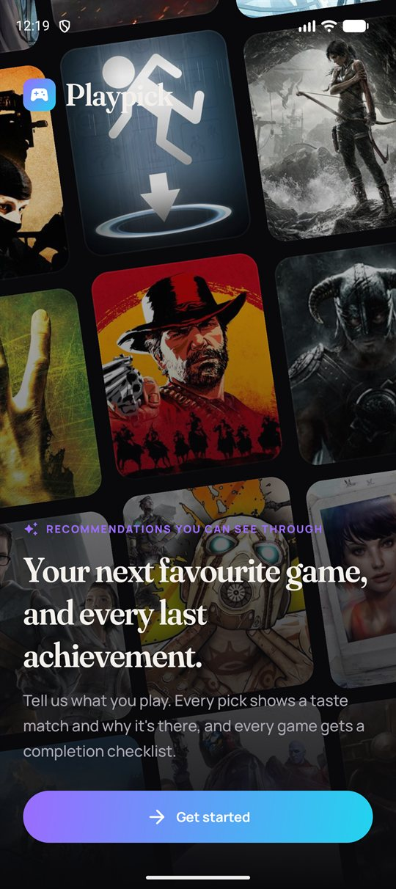

# Playpick: game recommendations with a completion checklist

Playpick learns what you play and recommends games you can actually play on your platforms. Every pick shows a **taste match** and **why it's there**, and every game in your library gets a **completion checklist** built from its achievement list, with rarity for each one. Finishing a game, and above all 100%-ing it, teaches the recommender more than anything else.

It's the second app in this repo, built on the same recommendation engine and design system as [Reelpick](../README.md). Data comes from [RAWG](https://rawg.io).

<table>
  <tr>
    <td align="center"><br><sub><b>For You</b>: per-platform</sub></td>
    <td align="center"><br><sub><b>Taste profile</b></sub></td>
    <td align="center"><br><sub><b>Details</b></sub></td>
    <td align="center"><br><sub><b>The hardest achievements</b></sub></td>
  </tr>
  <tr>
    <td align="center"><br><sub><b>Completion checklist</b></sub></td>
    <td align="center"><br><sub><b>Library</b></sub></td>
    <td align="center"><br><sub><b>Search</b></sub></td>
    <td align="center"><br><sub><b>Welcome</b></sub></td>
  </tr>
</table>

<sub>Captured on a Pixel emulator (Android 16) with live RAWG data.</sub>

## Features

- **Onboarding**: pick your platforms, at least 3 genres or tags, then 5 games you loved. They seed your first recommendations.
- **For You**: a hero carousel, Top 10, a taste-profile card, *Because you liked X*, *Short & sweet* (strong matches under ten hours), your genres and what's popular, with an **All / per-platform** switch that works instantly and offline.
- **Details**: rating and Metacritic, platforms, genres and tags, your taste match and the reasons behind it, screenshots, store links, the rest of the series, DLC, and more like it. An achievements card previews the three rarest.
- **Completion checklist**: every achievement with its icon (greyed until unlocked) and a rarity badge from global unlock rates. Filter to-do and done, sort by rarity, search. Ticking works offline; refreshing keeps your ticks. Ticking the last one offers to mark the game **100%**.
- **Library**: Playing, Backlog, Completed, 100% and Dropped, each game with a progress ring.
- **Settings**: platforms, theme, and a taste reset that keeps your library.

## How recommendations work

Playpick uses the shared engine in [`core/recommend`](../core/recommend), the same one Reelpick uses, with game-specific inputs:

- **Two feature spaces.** RAWG genres and tags have overlapping ids (genre 4 is Action, tag 4 is Funny), so the profile scores `GameFeature(GENRE, id)` and `GameFeature(TAG, id)` separately. Tags like *Metroidvania* or *Story Rich* carry most of the signal. Storefront tags (*Steam Achievements*, *Full controller support*), near-universal ones (*Singleplayer*) and non-English duplicates are filtered out ([`TagPolicy`](src/main/java/com/myth/playpick/data/remote/TagPolicy.kt)).
- **Signals** ([`GameTaste`](src/main/java/com/myth/playpick/domain/recommend/GameTaste.kt)):

  | Signal | Weight |
  |---|---|
  | Onboarding genre or tag | +1 |
  | Liked | +2 |
  | Backlog / Playing | +1 |
  | Completed | +2 |
  | 100% | +3 |
  | Disliked, not interested or dropped | −2 |

- **Candidates without "similar games".** RAWG's similar-games endpoint is paid, so [`CandidateSource`](src/main/java/com/myth/playpick/domain/recommend/CandidateSource.kt) reaches out from each of your 5 most recent favourites through its **series**, its **developers' other games**, and **popular games sharing its top tags**, plus discovery in your strongest genres and tags and the last 90 days' popular games. Everything is filtered to your platforms.
- **Ranking** reuses the shared scorer (taste affinity, seed support, Bayesian rating on RAWG's 5-point scale doubled, freshness). The diversity pass looks at genres only, since tags like *Atmospheric* are on nearly everything.

## Data and the free tier

- RAWG's free tier allows 20,000 requests a month and sends `Cache-Control: no-cache`, so responses are cached on disk for six hours ([`CacheInterceptor`](src/main/java/com/myth/playpick/data/remote/Interceptors.kt)), the feed is cached in Room per platform scope, and achievement lists are stored when first opened.
- The API key is a query parameter (RAWG accepts nothing else), so it's redacted from logs and debug builds only log at `BASIC`.
- Ticks live in their own table, apart from the achievement list, so re-syncing a list can never lose progress. A tick whose achievement disappears from RAWG simply stops counting.
- RAWG's terms require a link back on every screen that shows their data; each screen carries one.

## How to run

1. Get a free API key at [rawg.io/apidocs](https://rawg.io/apidocs).
2. Add it to `local.properties` in the repo root (git-ignored):
   ```properties
   RAWG_API_KEY=your_key
   ```
   On CI, set a `RAWG_API_KEY` repository secret.
3. Run the `games` configuration in Android Studio.

## Tests

```bash
./gradlew :games:testDebugUnitTest :core:recommend:test
```

```bash
./gradlew :games:connectedDebugAndroidTest
```

- **Unit tests** cover the mappers (against recorded RAWG responses, key scrubbed), tag filtering, the repository (pagination, partial failures), the taste weights, candidate sourcing and the feed (exclusions, the platform switch, seed rows, Short & sweet, caching), and the details, search, checklist and library view models.
- **Instrumented tests** cover the Room repositories (re-syncing keeps ticks) and Compose tests that tick an achievement and finish a list.

## Attribution

Game data and images are provided by [RAWG](https://rawg.io). Playpick is a non-commercial portfolio project and isn't affiliated with RAWG or any platform holder.
